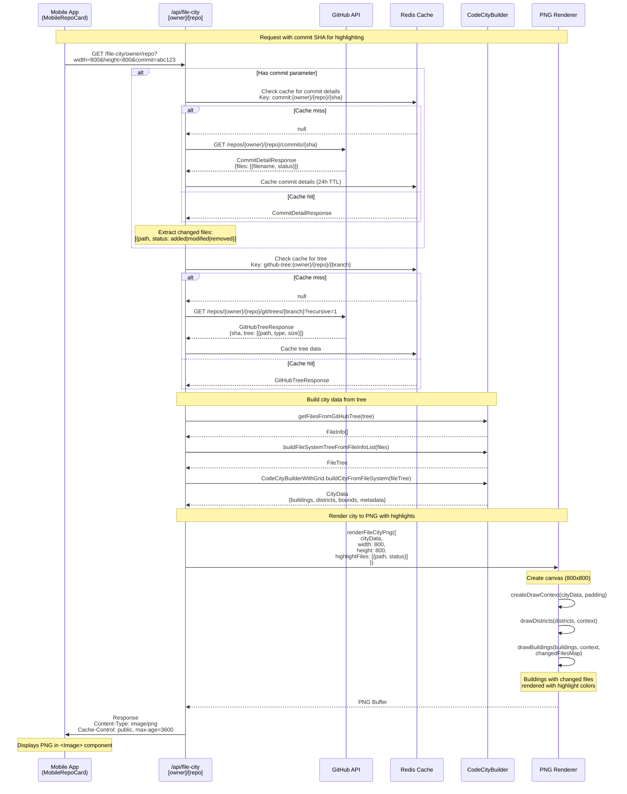
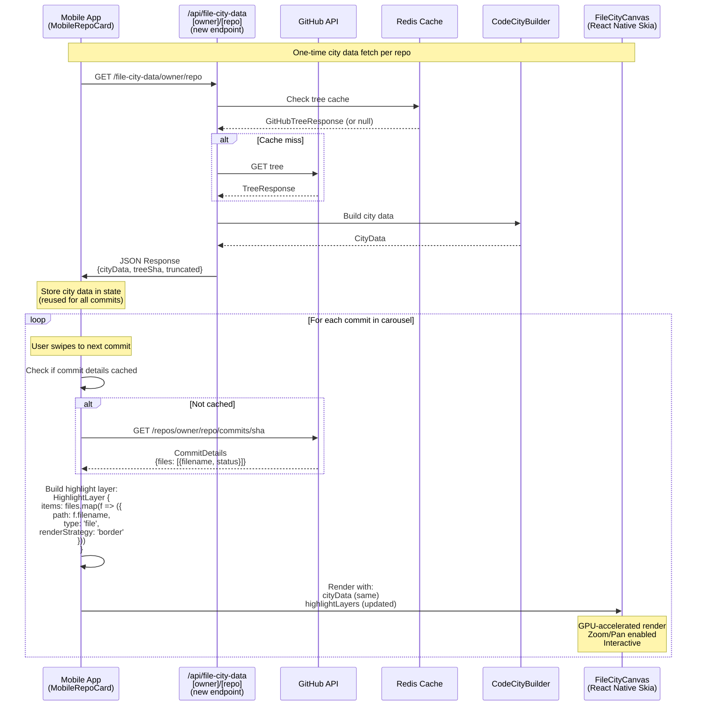

# File City Endpoint - Current Flow

## Endpoint: `GET /api/file-city/[owner]/[repo]`

This diagram shows how the server-side endpoint currently generates PNG images with optional commit highlighting.



## Key Points

### 1. **Server Has Full City Data**
The server builds complete `CityData` (buildings, districts, bounds) before rendering:
```typescript
const cityData = builder.buildCityFromFileSystem(fileTree, '');
// cityData.buildings: CityBuilding[]
// cityData.districts: CityDistrict[]
// cityData.bounds: { minX, maxX, minZ, maxZ }
```

### 2. **Commit Highlighting**
When `?commit=sha` is provided:
- Fetches commit details from GitHub API
- Extracts list of changed files with status
- Creates `changedFilesMap`: `Map<path, 'added'|'modified'|'deleted'>`
- Renderer uses this map to color buildings differently

### 3. **What Could Be Returned as JSON**
Instead of rendering to PNG, the endpoint could return:
```typescript
{
  cityData: CityData,              // Already built!
  highlightFiles: Array<{          // Already extracted!
    path: string,
    status: 'added' | 'modified' | 'removed'
  }>,
  treeSha: string,
  truncated: boolean
}
```

### 4. **Mobile App Already Has the Same Builder**
The mobile app (`FileCityService.ts`) uses the **exact same** `CodeCityBuilderWithGrid`:
```typescript
// Same imports as server
import { CodeCityBuilderWithGrid } from '@principal-ai/file-city-builder';

// Same build process
const builder = new CodeCityBuilderWithGrid();
const cityData = builder.buildCityFromFileSystem(fileTree, '');
```

## Current vs Potential Flow

### Current: Image-Based
```
Mobile → /file-city → GitHub Tree → Build City → Render PNG → Return Image
                    ↓
                  Redis Cache
```

### Potential: Data-Based
```
Mobile → /file-city-data → GitHub Tree → Build City → Return JSON
                         ↓
                       Redis Cache

Mobile builds highlight layer from commit file list
Mobile renders with FileCityCanvas (already exists)
```

## Performance Comparison

| Aspect | Current (PNG) | Potential (JSON + Canvas) |
|--------|--------------|---------------------------|
| **Bandwidth** | ~50-200KB per image | ~20-100KB JSON (one-time) |
| **Server CPU** | PNG encoding per request | JSON serialization |
| **Client CPU** | Image decode | Canvas rendering |
| **Caching** | Per width/height/commit | City data reusable |
| **Interactivity** | None | Full zoom/pan |
| **Commit switching** | New image per commit | Update highlight layer only |

## Proposed Alternative: JSON Data Flow



## Comparison: Data Payloads

### Current PNG Approach (per commit)
```json
Request:  GET /file-city/owner/repo?commit=abc123&width=800&height=800
Response: [Binary PNG Data: ~100-200KB]

Request:  GET /file-city/owner/repo?commit=def456&width=800&height=800
Response: [Binary PNG Data: ~100-200KB]

Request:  GET /file-city/owner/repo?commit=ghi789&width=800&height=800
Response: [Binary PNG Data: ~100-200KB]
```

**Total for 3 commits: ~300-600KB**

### Proposed JSON Approach (once + commit details)
```json
// One-time city data fetch
Request:  GET /file-city-data/owner/repo
Response: {
  "cityData": {
    "buildings": [...],     // ~50-100 buildings typical
    "districts": [...],     // ~10-20 districts
    "bounds": {...},
    "metadata": {...}
  },
  "treeSha": "abc123...",
  "truncated": false
}
// Size: ~20-80KB (depends on repo size)

// Commit details (likely already cached from card data)
Request:  GET /repos/owner/repo/commits/abc123
Response: {
  "files": [
    {"filename": "src/App.tsx", "status": "modified"},
    {"filename": "src/utils.ts", "status": "added"}
  ]
}
// Size: ~1-5KB per commit

// Subsequent commits just need file list
Request:  GET /repos/owner/repo/commits/def456
Response: { "files": [...] }  // ~1-5KB

Request:  GET /repos/owner/repo/commits/ghi789
Response: { "files": [...] }  // ~1-5KB
```

**Total for 3 commits: ~23-95KB (70-85% reduction)**

## Next Steps Options

### Option A: New Data Endpoint (Recommended)
Create `/api/file-city-data/[owner]/[repo]` that returns JSON instead of PNG.

**Pros:**
- Clean separation of concerns
- Can cache independently of images
- Mobile has full control over rendering
- Enables interactivity (zoom/pan)
- Reduces bandwidth for multi-commit cards

**Cons:**
- Need to create new endpoint
- Mobile needs to build highlight layers

### Option B: Extend Tree Endpoint
The `/github/repo/[owner]/[repo]?action=tree` endpoint could include city data in response.

**Pros:**
- Reuses existing endpoint
- No new route needed

**Cons:**
- Mixes concerns (tree data + city layout)
- Larger payload for clients who just want tree

### Option C: Client-Side Only (Current Mobile)
Mobile already fetches tree and builds city. Just needs commit file list for highlights.

**Pros:**
- No server changes needed
- Mobile has full control

**Cons:**
- Client does all the work (tree fetch + build)
- Slower initial load
- No server-side caching benefits
