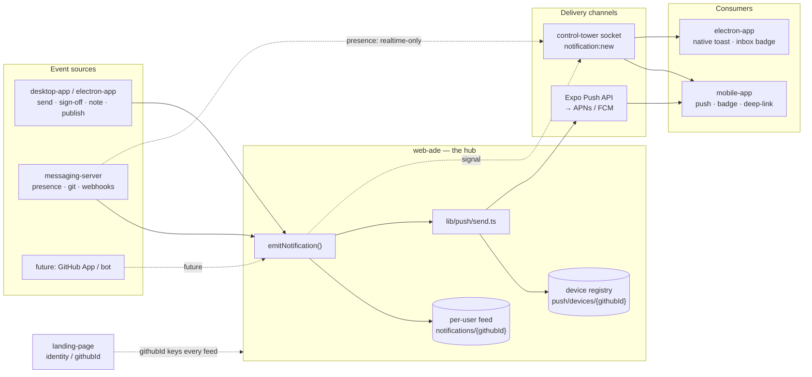
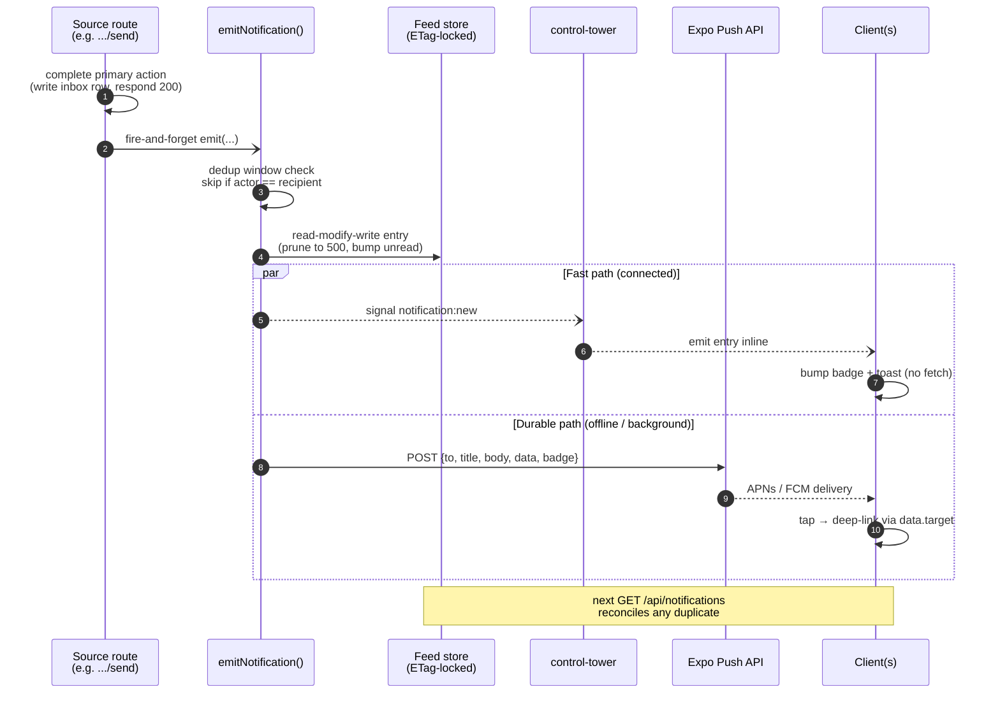
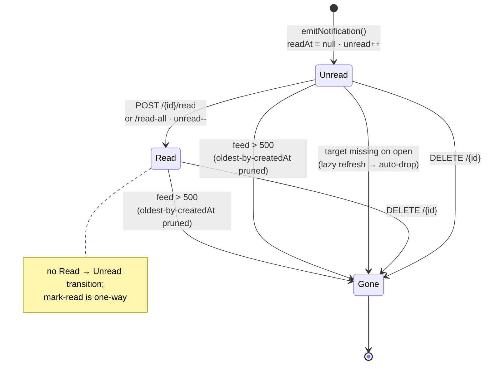
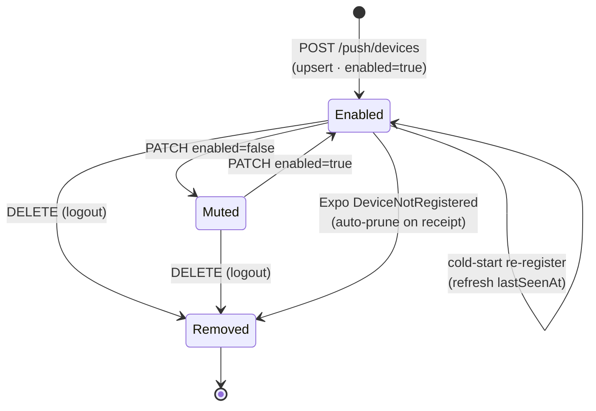
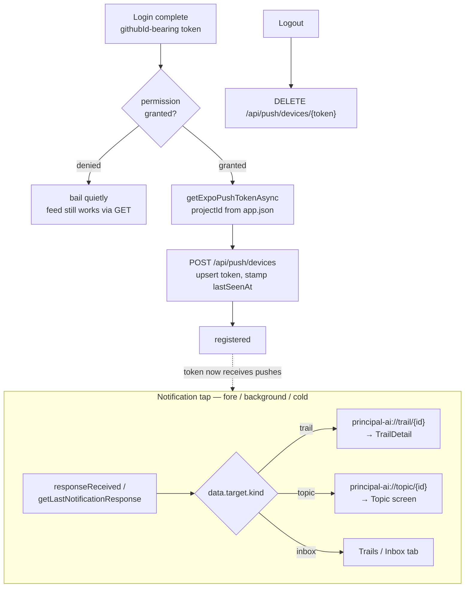
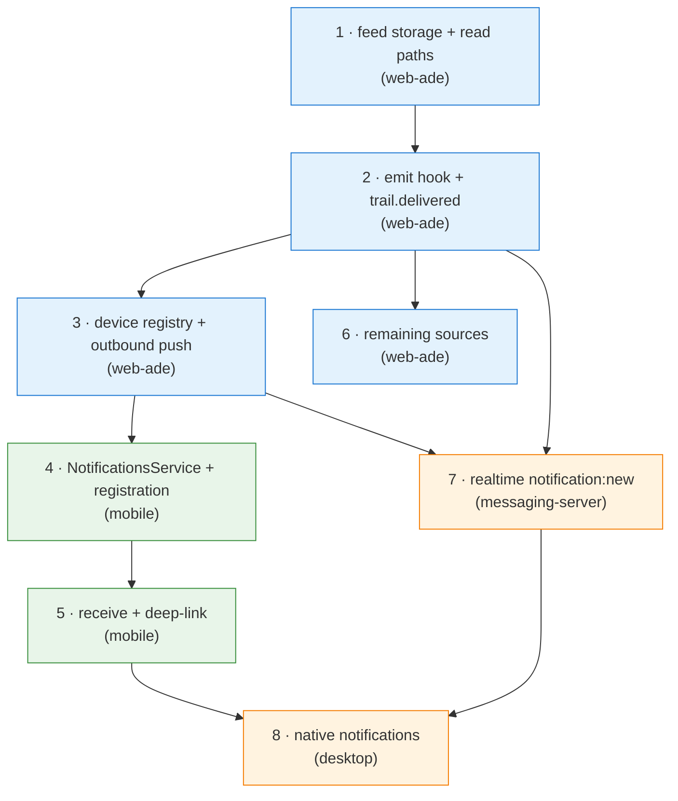

# Notifications — Cross-Project Design

How a **general notification system** is implemented across the Principal
projects: where events are born, where they're stored, and how they reach a
human on mobile, desktop, or in-app.

This is a design/build spec, not a description of shipped behavior. The pieces
it leans on already exist (the per-user inbox, stars, topics, the
control-tower realtime channel); the notification layer is the thin
generalization that sits over all of them.

Reference docs / code:
- `docs/TRAILS_API.md` §4 — the per-user **inbox** subsystem. Notifications
  generalize the exact pattern used there (per-user index keyed on numeric
  `githubId`, ETag-locked read-modify-write, snapshot-on-write, unread-count).
  §4f of that doc explicitly punts push to "the existing notification stack" —
  this doc is that follow-up.
- `docs/STARRED_TOPICS_TRAILS_API.md` — sibling spec; same storage/route idioms.
- `docs/LIVE_ACTIVITY.md` — the realtime stack (`@principal-ai/control-tower-core`
  → repository-traffic-controller) that supplies foreground/realtime delivery
  and presence-derived events.
- `web-ade/src/lib/trails/` and `web-ade/src/lib/topics/` — shipped storage +
  route patterns to mirror.

## 1. Mental model

A **notification** is a per-recipient, server-stamped record that *something
happened that a user should know about*. It is decoupled from both:

- **the event source** — a trail was sent to your inbox, someone signed off on
  your trail, a topic you authored gained a trail, a teammate came online; and
- **the delivery channel** — in-app badge, OS push (mobile), desktop toast
  (electron), or a realtime in-app toast over the websocket.

The existing **inbox** (`TRAILS_API.md` §4) is really the first, special-cased
notification feed: "a trail was delivered to you." Rather than bolt a second
parallel feed next to it, the design promotes the inbox's storage shape into a
**general per-user notification feed** that carries a discriminated `type`, and
treats "trail delivered" as one notification kind among many.

Three invariants carried over from the inbox/stars work, unchanged:

1. **web-ade is the source of truth.** Clients never invent notifications;
   they read the feed and render. The unread count is computed server-side.
2. **Keyed on numeric `githubId`**, never login — survives username changes.
3. **Snapshot-on-write.** Each notification embeds enough denormalized data to
   render its row without a fan-out fetch, refreshed lazily on open.

Delivery channels are **fan-out targets** off that single feed: writing a
notification optionally triggers a push (mobile) and a websocket emit
(foreground), but the feed is authoritative and survives a missed push.

## 2. Projects involved

The system spans five repos under `~/Developer`. Each has a distinct role; the
new build work is concentrated in **web-ade** (the hub) and **mobile-app** (the
new push consumer).

| Project | Role in notifications | New work |
|---|---|---|
| **web-ade** | The hub. Owns the per-user notification feed, the device-token registry, the fan-out engine, and the outbound push integration (Expo Push API → APNs/FCM). Every event source funnels through here. | **Large** — new `lib/notifications/` + `lib/push/`, routes, and emit-on-write hooks in the trail/topic/inbox/star code paths. |
| **mobile-app** (this repo, RN/Expo) | Push **consumer**. Registers an Expo push token, receives notifications in fore/background, taps deep-link into the right screen, drives the app-icon + tab badges off the feed. | **Medium** — add `expo-notifications`, a `NotificationsService` + `PushRegistration`, deep-link routing, badge wiring. |
| **desktop-app / electron-app** | Both a **producer** (publishing/sending trails & topics originate here — see the topic "Topic / Trail Inbox") and a **consumer** (native OS notifications via Electron's `Notification`, plus the existing inbox badge). | **Medium** — register a desktop "device" with the registry, render native notifications off the feed / websocket. |
| **messaging-server** (`control-tower-core` + `repository-traffic-controller`) | The **realtime channel**. Delivers notifications to connected clients instantly (foreground toast, live badge bump) and is itself a *source* of presence/git/push-webhook events that can become notifications. | **Small–Medium** — a `notification:*` event kind on the existing socket; optionally a server-side bridge so web-ade can emit to a user's connected sockets. |
| **landing-page** (auth server) | Identity. Supplies the GitHub/WorkOS tokens whose `githubId` keys every feed and every device-token row. No notification logic, but it's the trust root. | **None expected** — reuse existing auth. |

> If we later add a GitHub App / bot (`slack-app`, webhook ingest), it becomes
> another **event source** that POSTs into web-ade's emit API — no new channel.

The shape of the system — every source funnels through the web-ade hub, which
owns the durable feed and fans out to delivery channels:



## 3. Event sources → notification kinds

Each kind is a discriminated `type` on the feed entry. v1 reuses events the
codebase already produces; later kinds slot in without schema changes.

| `type` | Fires when | Source | Channels (v1) |
|---|---|---|---|
| `trail.delivered` | A trail is sent to your inbox (`POST /api/trails/by-id/{id}/send`) | web-ade (already writes the inbox row) | badge + push |
| `trail.signed_off` | Someone signs off on a trail **you authored** | web-ade sign-off route | badge + push |
| `trail.noted` | Someone adds a note to a trail you authored | web-ade note route | badge |
| `topic.shared` | A topic is shared/published to you | web-ade (topic publish — see topic work) | badge + push |
| `topic.trail_added` | A trail is added to a topic you authored/star | web-ade `addTrailToTopic` | badge |
| `star.received` | Someone stars your trail/topic | web-ade star route | badge |
| `presence.teammate_online` | A teammate comes online (opt-in, debounced) | messaging-server presence event | realtime toast only |

The first six are **durable** (they write a feed entry). The presence kind is
**ephemeral/realtime-only** in v1 — it rides the websocket and never persists,
matching `LIVE_ACTIVITY.md`'s "view-only / toast" recommendation.

## 4. Backend (web-ade) — the hub

### 4a. Storage layout

Mirrors the inbox tree (`TRAILS_API.md` §4a) — a per-user index plus per-entry
sidecars — and adds a device-token registry:

```
notifications/{githubId}/index.json          ← per-user feed (ETag-locked)
notifications/{githubId}/by-id/{notifId}.json ← per-entry sidecar (point reads)
push/devices/{githubId}.json                  ← registered push tokens (ETag-locked)
```

Feed shape:

```ts
interface NotificationFeed {
  version: 1;
  updatedAt: string;             // ISO 8601
  entries: NotificationEntry[];  // sorted by createdAt desc, soft-capped at 500
}

interface NotificationEntry {
  id: string;                    // server-generated, stable
  type: NotificationType;        // discriminated union tag (see §3)
  createdAt: string;             // ISO 8601, server-stamped
  readAt: string | null;         // server-stamped on mark-read
  /** Who/what triggered it. login captured at send-time for display. */
  actor: { githubId: number; githubLogin: string } | null; // null = system
  /** Free-text, optional (e.g. a sender comment on a delivered trail). */
  message?: string;
  /**
   * Where tapping it should land. Drives the deep link on every channel.
   * e.g. { kind: 'trail', id } | { kind: 'topic', id } | { kind: 'inbox' }
   */
  target: NotificationTarget;
  /**
   * Denormalized render data so a row paints with no fan-out fetch.
   * Per-type payload — for trail.delivered this is the SharedTrailIndexEntry
   * snapshot the inbox already captures; reuse it verbatim.
   */
  snapshot: unknown;             // narrowed by `type`
}
```

Device registry shape:

```ts
interface DeviceRegistry {
  version: 1;
  devices: PushDevice[];
}

interface PushDevice {
  /** Expo push token (mobile) or an electron channel id (desktop). */
  token: string;
  platform: 'ios' | 'android' | 'desktop';
  /** For pruning stale tokens. */
  lastSeenAt: string;
  /** Per-device mute, set from the client's settings screen. */
  enabled: boolean;
}
```

The same idioms as the inbox: ETag-locked read-modify-write on every mutation,
500-entry soft cap with oldest-by-`createdAt` pruned on append, lazy
snapshot-refresh + auto-drop on read when the underlying target is gone.

### 4b. The emit path (internal)

A single internal helper is the only writer of the feed:

```ts
// web-ade/src/lib/notifications/emit.ts
async function emitNotification(input: {
  recipientGithubId: number;
  type: NotificationType;
  actor?: { githubId: number; githubLogin: string };
  message?: string;
  target: NotificationTarget;
  snapshot: unknown;
  push?: boolean;     // also fan out to registered devices (default per-type)
}): Promise<NotificationEntry>
```

Existing routes call it as a **side effect**, never blocking the primary
response (fire-and-forget with logged failure):

- `POST /api/trails/by-id/{id}/send` → already writes the inbox row; *also*
  `emitNotification({ type: 'trail.delivered', push: true, ... })`.
- sign-off / note / star / topic-publish routes → emit their respective kinds,
  resolving the **author** as recipient (skip self-actions).

Idempotency: `emit` dedups on `(recipientGithubId, type, target.id, actor.githubId)`
within a short window so a double-POST doesn't double-notify — same spirit as
the inbox's `(trailId, sender, recipient)` idempotency.

The two delivery paths run off one write — the websocket is the fast path, the
push is the durable fallback, and the feed reconciles either on the next `GET`:



### 4c. Outbound push

`lib/push/send.ts` reads the recipient's `DeviceRegistry`, drops disabled /
stale tokens, and POSTs to the **Expo Push API**
(`https://exp.host/--/api/v2/push/send`) with `{ to, title, body, data, badge }`.
`data` carries the `target` so the app can deep-link on tap; `badge` is the
recipient's current unread count so the app icon stays correct. Expo relays to
APNs/FCM — no direct APNs certificate handling needed on the server. Receipt
errors (`DeviceNotRegistered`) prune the token from the registry.

### 4d. Routes

All routes auth via `Authorization: Bearer <github_token>` or the
`github_token` cookie; the caller's `githubId` is always the key.

| Method | Path | Purpose |
|---|---|---|
| `GET` | `/api/notifications` | List feed. Query: `unreadOnly`, `since`, `limit` (1–100, default 50), `cursor`. Returns `{ entries, unreadCount, cursor? }`. |
| `GET` | `/api/notifications/unread-count` | Badge helper → `{ count }`. |
| `POST` | `/api/notifications/{id}/read` | Mark one read (idempotent) → `{ readAt }`. |
| `POST` | `/api/notifications/read-all` | Clear the badge wholesale → `{ marked }`. |
| `DELETE` | `/api/notifications/{id}` | Remove one row (204). |
| `POST` | `/api/push/devices` | Register/refresh a device token. Body: `{ token, platform }`. Upserts on `token`, stamps `lastSeenAt`, `enabled: true`. → `{ device }`. |
| `DELETE` | `/api/push/devices/{token}` | Deregister (logout / disable). 204. |
| `PATCH` | `/api/push/devices/{token}` | Toggle `enabled` (per-device mute). → `{ device }`. |

The first five are the inbox routes generalized — implementing them is mostly a
copy of `TRAILS_API.md` §4b with `trailId` → `id` and the type discriminator
added.

### 4e. Object lifecycles (state machines)

The event *sources* in §3 (a trail, a topic, a teammate) are just triggers —
their state lives in the trails/topics subsystems and they only *call*
`emitNotification`. The notification layer owns two genuinely stateful records,
and these are the state machines to implement against.

**`NotificationEntry`** — the durable feed row. Born `Unread`, marked `Read`,
and eventually leaves the feed. The unread count and every badge are derived
purely from how many entries sit in `Unread`:



Note there is **no un-read** transition — `readAt` is stamped once and only
clears when the row leaves entirely. `Gone` collapses three different exits
(user delete, auto-drop of a dangling target, cap-prune) that all end the same
way: the row is no longer in the feed and no longer counted.

**`PushDevice`** — a registered token in `push/devices/{githubId}.json`.
Toggled mute-able, refreshed on every cold start, and removed on logout or a
hard delivery failure:



`send.ts` skips any device not in `Enabled` (a `Muted` token is kept but never
pushed to), and a `DeviceNotRegistered` receipt is what turns a silently-dead
token into `Removed` without the client doing anything.

## 5. Mobile (this repo) — push consumer

### 5a. Dependencies

```json
{ "expo-notifications": "~55.0.x", "expo-device": "~55.0.x" }
```

`expo-notifications` handles permission prompts, token acquisition, fore/background
handlers, and the app-icon badge. `expo-device` gates token requests to physical
devices (the simulator can't get a real APNs token).

### 5b. Token registration

A new `src/services/NotificationsService.ts` (mirroring `TrailsApiService.ts`):

```ts
// Feed (server is source of truth — same shape as the inbox service)
export function getNotifications(token: string, opts?: {...}): Promise<{ entries; unreadCount; cursor? }>;
export function getUnreadCount(token: string): Promise<number>;
export function markRead(id: string, token: string): Promise<{ readAt: string }>;
export function markAllRead(token: string): Promise<{ marked: number }>;
export function deleteNotification(id: string, token: string): Promise<void>;

// Push device registration
export function registerDevice(expoPushToken: string, platform: string, token: string): Promise<void>;
export function deregisterDevice(expoPushToken: string, token: string): Promise<void>;
```

Registration flow, run after login (we have a `githubId`-bearing token from
`AuthService`):

1. `Notifications.requestPermissionsAsync()` — bail quietly if denied.
2. `Notifications.getExpoPushTokenAsync({ projectId })` — needs the EAS
   `projectId` from `app.json`.
3. `POST /api/push/devices` with the token. Re-run on every cold start (cheap
   upsert; refreshes `lastSeenAt`).
4. On logout, `DELETE /api/push/devices/{token}` so a shared device stops
   getting the previous user's pushes.

### 5c. Receiving + deep-linking

- **Foreground:** `Notifications.setNotificationHandler` decides whether to
  show a banner; we bump the in-app badge off the `data.badge` field and/or a
  realtime websocket event (§7) without a network round-trip.
- **Tap (fore/background/cold):** `Notifications.addNotificationResponseReceivedListener`
  reads `data.target` and routes via the existing `principal-ai://` scheme:
  - `{ kind: 'trail', id }` → `principal-ai://trail/{id}` → TrailDetail
    (the deep-link target proposed in `TRAILS_API.md` §6.5, still unwired).
  - `{ kind: 'topic', id }` → `principal-ai://topic/{id}` → topic screen
    (the topic screen is the open item flagged in both this repo and the
    desktop "Topic / Trail Inbox" topic).
  - `{ kind: 'inbox' }` → the Trails/Inbox tab.

  Cold-start taps are read via `getLastNotificationResponseAsync()` during app
  init so a tap that launched the app still lands on the right screen.

The mobile lifecycle — register a token after login, then route every tap
through the existing `principal-ai://` deep-link scheme:



### 5d. Badges

- **App icon:** `setBadgeCountAsync(unreadCount)` on the value pushed in
  `data.badge`, and re-synced from `getUnreadCount()` on foreground.
- **Tab badge:** the Trails/Inbox tab unread dot (the `TRAILS_API.md` §7
  "Tab unread badge — not wired" row) is driven off the same count.

## 6. Desktop (electron-app) — producer + consumer

The desktop app is where most events are *authored* (publishing/sending trails
and topics — see the "Topic / Trail Inbox" topic). For notifications it:

- Registers a `platform: 'desktop'` device on the registry (a channel id, not
  an Expo token), or — simpler — relies purely on the realtime websocket (§7)
  since it holds a live control-tower connection while open.
- Renders native OS notifications via Electron's `Notification` API off the
  feed / websocket, deep-linking into the existing Inbox view + topic tabs that
  the topic work already shipped.

This is largely a consumer of the same web-ade feed; no new storage.

## 7. Realtime delivery (messaging-server)

For **connected** clients (desktop always; mobile while foregrounded), pushing
through APNs/FCM is slow and lossy. The control-tower socket from
`LIVE_ACTIVITY.md` delivers instantly:

- Add a `notification:new` event kind on the existing socket. When web-ade's
  `emitNotification` writes a feed entry, it (optionally) signals
  repository-traffic-controller to emit `notification:new` to that user's
  connected sockets with the entry inline.
- Clients bump the badge + show an in-app toast with **no fetch**.
- The durable push (§4c) still fires for offline/background recipients — the
  two are complementary; the feed reconciles any duplicate on next `GET`.
- `presence.teammate_online` (§3) is realtime-**only** and never touches the
  feed.

This keeps the websocket as the fast path and the web-ade feed as the durable
path, so a missed socket message is always recoverable on next list.

## 8. Build order

Lighter slices first so each layer has something to talk to:

1. **web-ade — feed storage + read paths.** `lib/notifications/` (feed type,
   ETag-locked index + sidecars, 500-cap prune, lazy refresh/drop),
   `GET /api/notifications` (+ `unread-count`), `read`/`read-all`/`DELETE`.
   This is the inbox code generalized with a `type` tag.
2. **web-ade — emit hook + first source.** `emitNotification` helper; wire it
   into `POST .../send` for `trail.delivered` (the inbox already writes there —
   add the emit alongside). Verifies the feed end-to-end with one real source.
3. **web-ade — device registry + outbound push.** `push/devices/*` routes,
   `lib/push/send.ts` (Expo Push API), badge + receipt-error pruning. Wire
   `push: true` into the `trail.delivered` emit.
4. **mobile — `NotificationsService` + registration.** Add `expo-notifications`,
   request permission post-login, register/deregister the token, drive the
   app-icon + tab badge off `unread-count`.
5. **mobile — receive + deep-link.** Foreground handler, tap → `principal-ai://`
   routing (needs the trail/topic deep-link targets from `TRAILS_API.md` §6.5),
   cold-start tap handling.
6. **web-ade — remaining sources.** sign-off, note, star, topic-publish/
   trail-added emits, each resolving the right recipient.
7. **realtime (messaging-server).** `notification:new` socket event + web-ade →
   controller bridge; foreground toast on mobile, native toast on desktop.
8. **desktop — native notifications** off the feed/socket, deep-linking into the
   existing Inbox + topic tabs.

Slices 1–3 are server-only and unblock everything; 4–5 give mobile real pushes;
6–8 broaden sources and channels.



## 9. Open questions / decisions

1. **One feed or two?** This doc folds the trails **inbox** into a general feed
   with `type: 'trail.delivered'`. Alternative: keep the inbox separate and add
   notifications as a sibling that *references* inbox rows. Folding is cleaner
   long-term but means migrating the shipped inbox storage. **Lean: keep the
   inbox as-is for v1, add the general feed beside it, and have `trail.delivered`
   notifications point at the existing inbox row** — no migration, at the cost
   of two indexes. Revisit unification later.
2. **Expo vs. direct APNs/FCM.** Expo Push API is far less ops (no cert
   handling) and matches the Expo runtime. Direct APNs gives more control
   (collapse ids, richer payloads) at real cost. **Lean: Expo for v1.**
3. **Notification preferences granularity.** Per-device mute (in the registry)
   vs. per-`type` preferences (e.g. "push me on sign-offs but not stars").
   v1 ships per-device on/off; per-type is a later `preferences/{githubId}.json`.
4. **Realtime bridge coupling.** Does web-ade call repository-traffic-controller
   directly (HTTP emit endpoint), or does the controller subscribe to a web-ade
   event stream? Direct HTTP is simplest for v1; revisit if fan-out volume grows.
5. **Self-notifications.** Suppress notifications for your own actions (you
   signing off your own trail). Default: **suppress** — `emit` skips when
   `actor.githubId === recipientGithubId`.
6. **Presence noise.** `teammate_online` could be chatty. v1: opt-in, debounced
   per teammate per session, realtime-toast-only, never persisted.
7. **Badge accuracy when multiple devices.** The push `badge` is the server's
   unread count at send-time; with two devices a read on one leaves the other
   stale until its next foreground sync. Acceptable for v1 (foreground re-syncs).

None of these block slices 1–3; they shape the mobile + realtime PRs.
